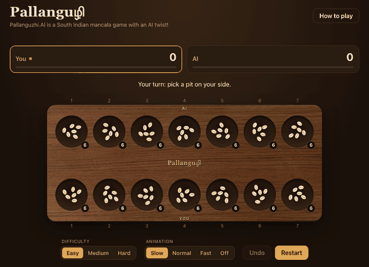
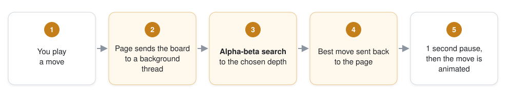

# Pallanguzhi.AI

[](https://github.com/saaaathvik/pallanguzhi.ai/actions/workflows/ci.yml)
[](https://pallanguzhi-ai.vercel.app/)

**Play it:** [pallanguzhi-ai.vercel.app](https://pallanguzhi-ai.vercel.app/)

Pallanguzhi.AI is a South Indian mancala game with an AI twist! Play **Pallanguzhi**, a traditional two-player game of sowing and capturing shells, against an AI opponent that searches ahead using minimax with alpha-beta pruning. Everything runs in the browser, with no backend.



## Tech stack

| Area | Tools |
|---|---|
| Frontend | React 19, TypeScript, Vite |
| AI | Minimax with alpha-beta pruning and lazy move generation, run in a Web Worker |
| Quality | Vitest, ESLint, TypeScript strict mode |
| CI/CD | GitHub Actions (lint, type-check, test, build on every push and pull request) |
| Hosting | Vercel (static build, preview deployment for every pull request) |

## Features

- AI opponent that looks up to 5 moves ahead
- Three difficulty levels: Easy, Medium and Hard
- Animated sowing and captures, with Slow, Normal, Fast or Off speeds
- Undo (takes back your move and the AI's reply) and restart
- In-game rules, shown on the first visit
- Settings remembered between visits
- Responsive layout and keyboard-accessible controls

## How to play

The board has two rows of 7 pits with 6 shells each (84 in total). The bottom row is yours and the top row is the AI's. You move first.

1. Pick a pit on your side that has shells.
2. Take all its shells and sow them one per pit anticlockwise: left to right along your row, then right to left along the AI's row.
3. If the pit after your last shell has shells, pick them up and keep sowing.
4. If it is empty, your turn ends and you capture the shells in the pit just after it.

Capturing more than 42 shells wins immediately. Otherwise the game ends when the player to move has no shells on their side; each player keeps the shells left on their own side, and the higher total wins.

## How the AI works

The AI treats the game as a tree of positions. Each move leads to a new position, and the AI looks a fixed number of moves ahead (its **depth**) to pick the move that leaves it best off.



**Scoring.** A position is scored as *AI captures minus your captures*. At the end of the game, the shells left on each side are added to that side's total.

**Minimax.** The AI assumes both players play their best: on its turns it picks the move with the highest score, and on yours it assumes you pick the move with the lowest.

**Alpha-beta pruning.** While searching, the AI keeps track of the best score each side is already guaranteed (alpha for the AI, beta for you). As soon as a move is shown to be worse than an option already found, the rest of that branch is skipped, because a sensible player would never choose it.

**Lazy move generation.** Positions are simulated only when the search reaches them, so pruned branches are never built. Compared with building the full tree to the same depth first:

| Depth | Full tree (avg positions) | Lazy search (avg positions) | Reduction |
|---|---|---|---|
| 1 (Easy) | 5 | 5 | 0.0% |
| 3 (Medium) | 123 | 64 | 47.6% |
| 5 (Hard) | 2,686 | 560 | 79.2% |
| 6 | 12,612 | 1,526 | 87.9% |

**Difficulty.** Easy searches 1 move ahead and plays a random move 30% of the time. Medium searches 3 moves ahead and Hard searches 5, both always playing their best move.

**Background thread.** The search runs in a Web Worker, so the page stays responsive while the AI thinks. The page sends the board to the worker as a message and receives the chosen move back.

### Latency

Search time per move, over 200 random positions (`npm run bench`, Apple M2, Node 18):

| Depth | Median | Slowest |
|---|---|---|
| 1 (Easy) | under 0.01 ms | 0.12 ms |
| 3 (Medium) | 0.03 ms | 0.26 ms |
| 5 (Hard) | 0.15 ms | 5.65 ms |
| 6 | 0.43 ms | 11.49 ms |

Every search finishes in well under 1 second. The AI then waits a deliberate 1 second before replying, so its move is easy to follow.

## Project structure

```
src/
  engine/            Game rules and AI (pure TypeScript, no React)
    rules.ts         Board, sowing, captures, game end
    ai.ts            Minimax with alpha-beta pruning, difficulty levels
    ai.worker.ts     Web Worker entry point
    aiClient.ts      Promise-based client for the worker
  hooks/useGame.ts   Turn flow, animation, undo and restart
  components/        Board, shells, dialogs, rules
scripts/bench.ts     Search benchmark
```

## Running locally

Requires Node 18.18 or later.

```bash
npm install
npm run dev        # start the dev server
npm test           # run the tests
npm run lint       # ESLint
npm run typecheck  # TypeScript
npm run build      # production build in dist/
npm run bench      # search benchmark
```

## Authors

Made by Saathvik Balaji and Shwetha Suresh Nathan.
